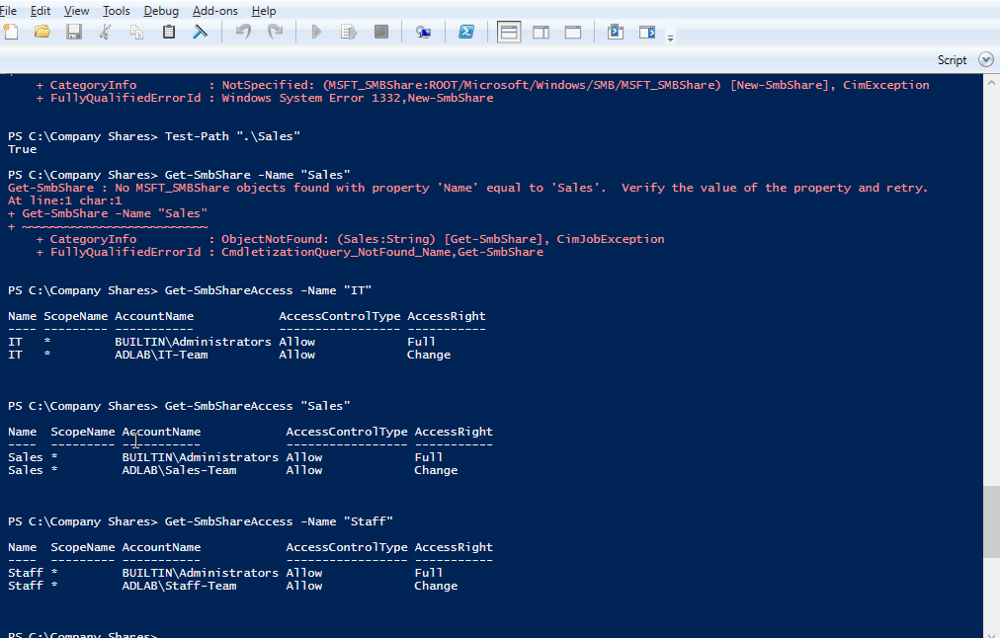
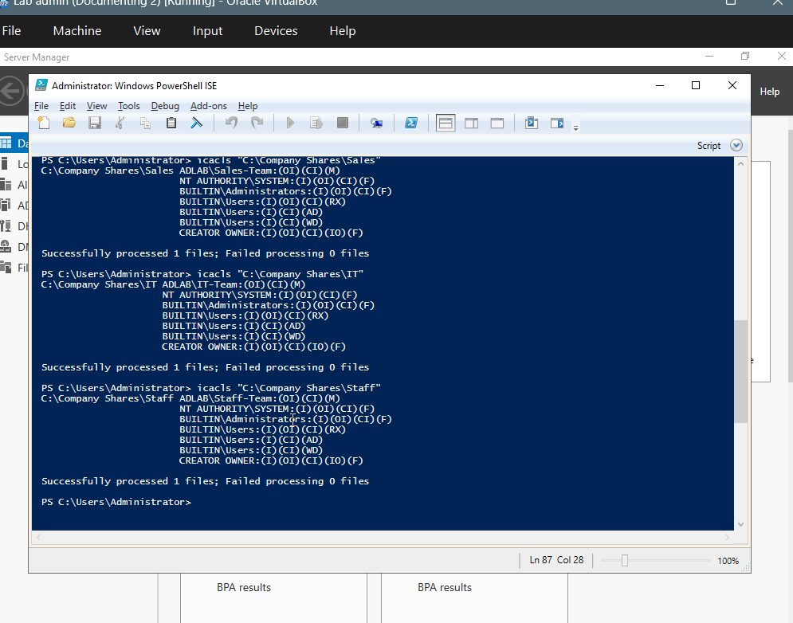
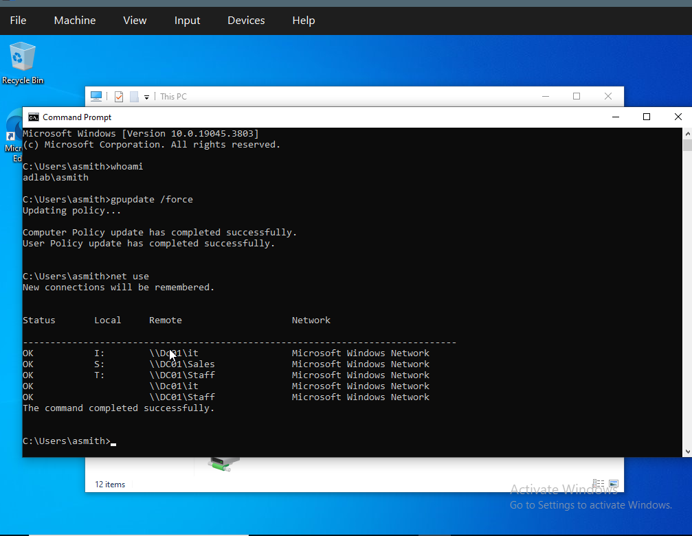
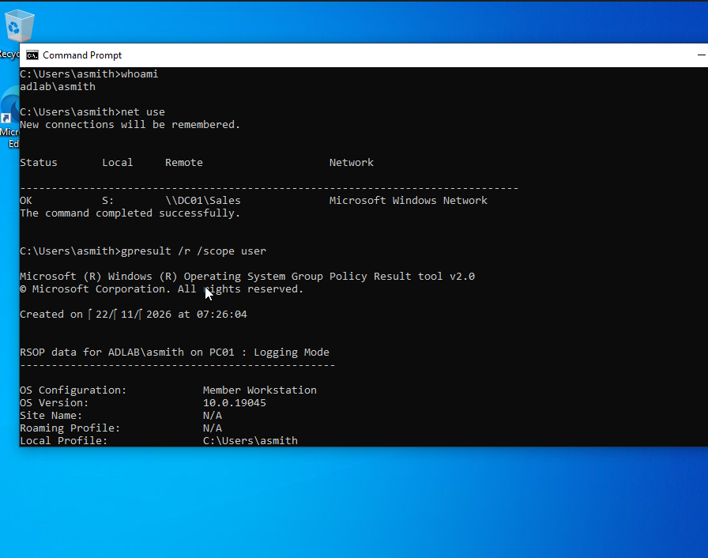

# Troubleshooting Log

## 1. Summary

Investigated and resolved technical issues encountered during the deployment and administration of the Active Directory home lab.

Troubleshooting covered VirtualBox configuration, network connectivity, DNS resolution, SMB file sharing, NTFS permissions and Group Policy targeting.

Used Windows administrative tools, PowerShell and client-side testing to identify problems, correct configurations and verify results.

The most significant investigations involved correcting NTFS permission inheritance and resolving incorrect departmental Group Policy application.

## 2. Overview

The troubleshooting activities were performed across DC01 (Windows Server 2022) and PC01 (Windows 10 Pro) within the `adlab.test` domain.

| Issue | Problem | Outcome |
|---|---|---|
| 01 | VirtualBox installation boot loop | Resolved |
| 02 | Virtual network connectivity | Resolved |
| 03 | DNS lookup and reverse resolution | Forward DNS verified |
| 04 | SMB share creation error 1332 | Resolved |
| 05 | Unintended NTFS permission inheritance | Identified issue resolved |
| 06 | Incorrect departmental GPO targeting | Resolved |

## 3. Troubleshooting Records

### Issue 01: Windows Server Installation Boot Loop

**Problem:** Following installation, the virtual machine repeatedly returned to Windows Setup instead of starting the installed operating system.

**Investigation:** Inspected the virtual machine's boot order and attached installation media.

**Root Cause:** The installation ISO continued taking priority during startup.

**Resolution:** Removed the ISO and configured VirtualBox to prioritise the virtual hard disk.

**Verification:** DC01 successfully booted into Windows Server 2022 without restarting the installation process.

**Result: RESOLVED**

[View Lab Architecture and Virtual Machine Configuration](../01-Lab-Architecture/README.md)

### Issue 02: Virtual Network Connectivity

**Problem:** Initial network settings prevented consistent communication between DC01 and PC01.

**Investigation:** Reviewed the VirtualBox network adapters, IPv4 settings and DNS configuration.

**Resolution:**

- Connected both VMs to the `ADLabNet` Internal Network.
- Configured DC01 with the static address `192.168.50.10`.
- Configured PC01 to use DC01 for DNS.
- Subsequently enabled DHCP for automatic client addressing.

**Verification:** PC01 successfully joined the domain and obtained `192.168.50.100` from the DHCP server on DC01.

**Result: RESOLVED**

**Evidence: DHCP client configuration**

[View Network Services Documentation](../03-Network-Services/README.md)

### Issue 03: DNS Lookup and Reverse Resolution

**Problem:** During DNS testing, `nslookup` displayed `Server: UnKnown`. Lookup timeouts were also observed.

**Investigation:** Reviewed DNS settings, forward lookup records and reverse DNS configuration.

**Finding:** A missing reverse lookup configuration explained the unidentified DNS server name. The cause of the separate timeouts was not conclusively established.

**Resolution:** Created a reverse lookup zone and PTR record for DC01.

**Verification:** Successfully tested forward DNS resolution through `192.168.50.10` using `Resolve-DnsName`.

The available evidence confirms forward resolution rather than independently proving the final reverse lookup result.

**Result: FORWARD DNS VERIFIED**

**Evidence: DNS resolution test**

### Issue 04: SMB Share Creation Error 1332

**Problem:** PowerShell returned Windows error 1332 during SMB share creation because an account name could not be mapped to a security identifier.

**Investigation:** Reviewed the administrative security principal specified during share creation.

**Root Cause:** The supplied account reference was not successfully resolved.

**Resolution:** Corrected the security principal to `BUILTIN\Administrators` and completed the SMB share configuration.

**Verification:** Used `Get-SmbShareAccess` to confirm departmental groups received Change access and Administrators received Full Control.

**Result: RESOLVED**

**Evidence: SMB share permissions**

### Issue 05: Unintended NTFS Permission Inheritance

**Problem:** NTFS verification revealed that IT-Team inherited Modify permissions on the Sales and Staff folders, contrary to the intended departmental permission structure.

**Investigation:** Used `icacls` to inspect folder access control entries and the parent directory, `C:\Company Shares`.

Identified an inheritable IT-Team Modify entry on the parent folder.

**Root Cause:** The parent directory's permission propagated to departmental subfolders.

**Resolution:**

- Removed the unintended IT-Team permission from the parent directory.
- Verified the resulting departmental permissions.
- Disabled inheritance on the Sales folder and removed broad `BUILTIN\Users` entries as an additional security improvement.

**Verification:** Confirmed each folder retained its respective departmental Modify permission.

The final Sales ACL retained Sales-Team Modify access alongside SYSTEM and Administrators Full Control.

Additional inherited Users entries on IT and Staff remained outside the Sales hardening work.

**Result: IDENTIFIED INHERITANCE ISSUE RESOLVED**

**Evidence: Corrected departmental permissions**

**Additional evidence:**

[Final Sales NTFS Permissions After Hardening](../04-File-Server-and-Permissions/03-Sales-NTFS-Final-Permissions.png)

### Issue 06: Incorrect Departmental Group Policy Targeting

**Problem:** Initial client testing revealed that departmental users received all three mapped network drives instead of only their assigned departmental drive.

**Investigation:**

Used `whoami`, `net use` and `gpresult /r /scope user` to inspect user identity, network connections and applied GPOs.

Discovered that the departmental GPOs were linked at the domain level, causing them to apply beyond their intended departments.

**Root Cause:** Incorrect GPO link placement, combined with previously created network drive connections persisting after policy changes.

**Resolution:**

- Removed unnecessary domain-level GPO links.
- Confirmed each departmental GPO was linked to its corresponding OU.
- Cleared outdated network connections using `net use * /delete /y`.
- Refreshed Group Policy and signed out and back in.

**Verification:** Retested Sales, IT and Staff domain accounts.

| Department | Applied GPO | Mapped Drive |
|---|---|---|
| Sales | Sales-Mapped-Drive | S: |
| IT | IT-Mapped-Drive | I: |
| Staff | Staff-Mapped-Drive | T: |

All three departments received their intended GPO and network drive.

**Before correction:**

The Sales account received S:, I: and T: due to incorrect GPO application.

**After correction:**

The Sales account received only S: mapped to `\\DC01\Sales`.

[View Corrected Sales GPO Results](../05-Group-Policy/Sales-GPO-Results.png)

[View Complete Departmental GPO Verification](../05-Group-Policy/README.md)

**Result: RESOLVED**

## 4. Key Learning Outcomes

These troubleshooting activities strengthened my ability to identify technical problems, investigate configuration dependencies and verify corrective actions.

The NTFS and Group Policy incidents demonstrated the importance of permission inheritance, GPO scope and the difference between configured settings and observed client behaviour.

The project also reinforced the need to distinguish symptoms from confirmed root causes and maintain accurate technical documentation.

---

[Return to Main Project README](../README.md)
